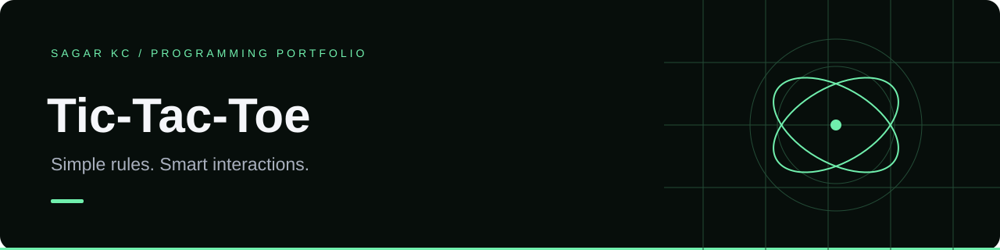

# Tic-Tac-Toe

A responsive two-player browser game built with HTML, CSS, and JavaScript.

## Play

Open `index.html` in a browser. X and O take turns; get three marks in a row, column, or diagonal to win.

## Features

- All eight winning lines and draw detection
- Winning-line highlighting and a new-game button
- Occupied cells and completed boards cannot be played again
- Keyboard-accessible buttons and live status announcements
- Responsive layout with no dependencies

## How it works

`outcome(board)` checks each possible winning line. Event handlers update the board and render the next state. The logic is exported for Node.js testing and shared with the browser interface.

## Next improvements

A score counter, computer opponent, and difficulty selection.
